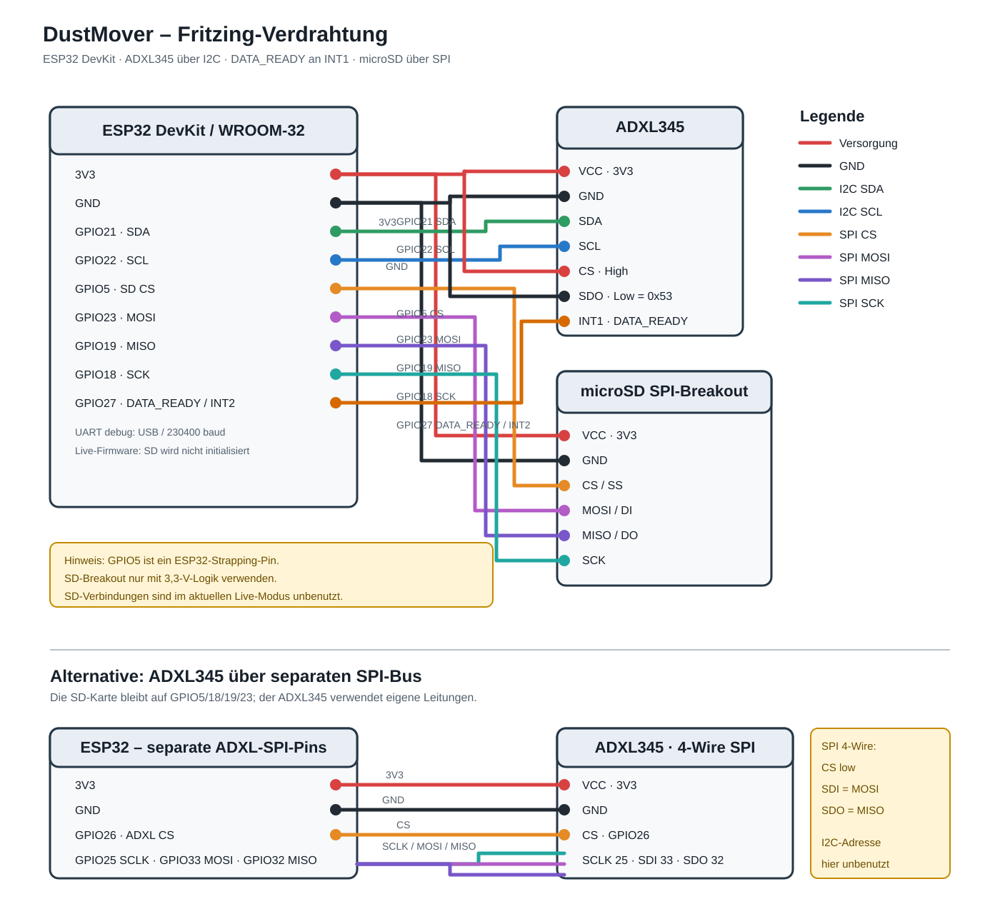

# dustmover
sensor sytem for detection of position and acceleration with data logging on SD-Card

## Neuer Einstieg: ESP32, Arduino und FreeRTOS

Eine separate Projektbasis liegt in `firmware/DustMover/`. PlatformIO baut diese
über `platformio.ini`; der ursprüngliche Sketch unten bleibt als Referenz erhalten.
Einrichtung, Architektur, Verdrahtung und Grenzen: [Toolchain und Projektstart](docs/TOOLCHAIN.md).

## ICM-42688-P über SPI

Die ESP32-Firmware liest Beschleunigung und Drehrate über SPI mit nominell
100 Hz und gibt die Messwerte am seriellen Monitor mit 230400 Baud aus.

- [ICM-42688 SPI-Schaltskizze (SVG)](docs/icm42688-spi-schematic.svg)
- [Pinbeschreibung und Kabelfarben zum Löten](docs/icm42688-spi-lotbeschreibung.md)

Der Sensor verwendet `GPIO18 = SCK`, `GPIO23 = MOSI`, `GPIO19 = MISO`
und `GPIO5 = CS`. Der Data-Ready-Interrupt startet den Lesevorgang.
Dazu `INT2` mit `GPIO27` verbinden.

Build für den klassischen ESP32 DevKit mit `pio run -e esp32dev`. Für
einen Aufbau mit Kartenleser ist `esp32dev_sd` verfügbar.

## Frühere Verdrahtung mit ADXL345

The previous ESP32/ADXL345 wiring is shown in the Fritzing-style diagram:

Open the [full-size wiring diagram](docs/dustmover-wiring.svg) or the
[detailed wiring notes](docs/dustmover-fritzing-wiring.md).

Previous live-measurement connections:

| ADXL345 | ESP32 | Function |
| --- | --- | --- |
| VCC | 3V3 | 3.3 V supply |
| GND | GND | Common ground |
| SDA | GPIO21 | I²C data |
| SCL | GPIO22 | I²C clock |
| CS | 3V3 | I²C mode |
| SDO/ALT | GND | I²C address `0x53` |
| INT1 | Not connected | Not used |
| INT2 | GPIO27 | `DATA_READY` at 100 Hz |

## References

- [Analog Devices ADXL345 datasheet, Rev. G (PDF)](https://www.analog.com/media/en/technical-documentation/data-sheets/adxl345.pdf)
- [Analog Devices ADXL345 product page](https://www.analog.com/en/products/adxl345.html)

*Usage of*
- SD-Card (for logging)
- ADXL 345 acceleration sensor 

# SD-Card Interface (ESP32 used) (VDD 3.3V)

CS (SS) = GPIO5
DI (MOSI) = GPIO23
VDD = 3.3 V
SCK (SCLK) = GPIO18
VSS = GND
DO (MISO) = GPIO19

Examples:
    listDir(SD, "/", 0);
    createDir(SD, "/mydir");
    listDir(SD, "/", 0);
    removeDir(SD, "/mydir");
    listDir(SD, "/", 2);
    writeFile(SD, "/hello.txt", "Hello ");
    appendFile(SD, "/hello.txt", "World!\n");
    readFile(SD, "/hello.txt");
    deleteFile(SD, "/foo.txt");
    renameFile(SD, "/hello.txt", "/foo.txt");
    readFile(SD, "/foo.txt");
    testFileIO(SD, "/test.txt");
 
For more info see file README.md in this library or on URL:
https://github.com/espressif/arduino-esp32/tree/master/libraries/SD

# ADXL345 (I2C interface used) (VDD 3.3V)
- INT2 / DATA_READY (connected to GPIO27)
- INT1 not connected; GPIO2 remains open as an ESP32 strapping pin
- SCL (GPIO22)
- SDA (GPIO21)

Examples:
/* Choose the data rate         Hz
    ADXL343_DATA_RATE_3200    3200
    ADXL343_DATA_RATE_1600    1600
    ADXL343_DATA_RATE_800      800
    ADXL343_DATA_RATE_400      400
    ADXL343_DATA_RATE_200      200
    ADXL343_DATA_RATE_100      100
    ADXL343_DATA_RATE_50        50
    ADXL343_DATA_RATE_25        25
    ADXL343_DATA_RATE_12_5      12.5  
    ADXL343_DATA_RATE_6_25       6.25
    ADXL343_DATA_RATE_3_13       3.13
    ADXL343_DATA_RATE_1_56       1.56
    ADXL343_DATA_RATE_0_78       0.78
    ADXL343_DATA_RATE_0_39       0.39
    ADXL343_DATA_RATE_0_20       0.20
    ADXL343_DATA_RATE_0_10       0.10
*/

/* Choose the measurement range
    ADXL343_RANGE_16G    16g     
    ADXL343_RANGE_8G      8g     
    ADXL343_RANGE_4G      4g   
    ADXL343_RANGE_2G      2g
*/ 

# LED (build-in LED) GPIO16

